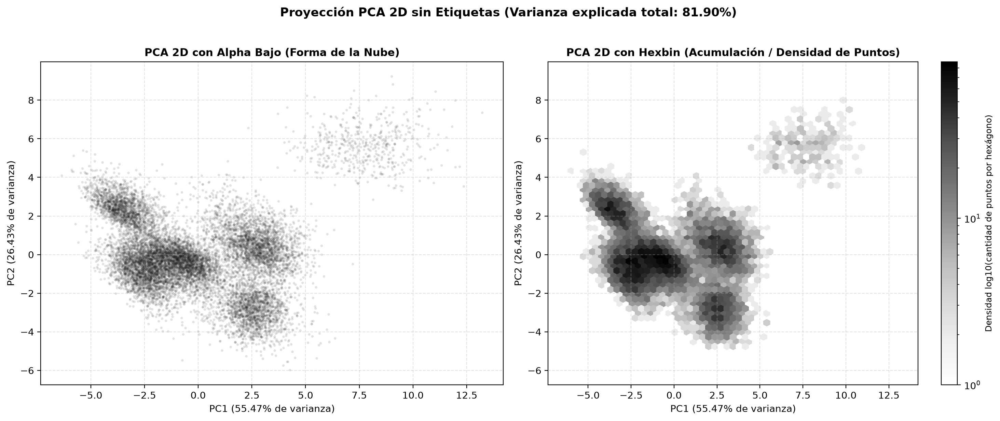

# Análisis Exploratorio del Dataset (`Dataset.csv`)

En esta etapa realizamos una inspección inicial del archivo `Dataset.csv` con el objetivo de entender qué contienen los datos, detectar problemas de calidad y justificar los pasos a seguir en el preprocesamiento.

---

## Traducción al español de la descripción original (`Dataset.txt`)

- **Nombre del conjunto de datos:** `Dataset`
- **Resumen:** 13,611 granos. Se obtuvieron un total de 16 características a partir de los granos: 12 dimensiones y 4 formas.
- **Tipo de datos:** Multivariado
- **Tarea:** Clasificación
- **Tipo de atributo:** Categórico, Entero, Real
- **Tipo de formato:** Matriz
- **Número de instancias (registros en su conjunto de datos):** 13611
- **Número de atributos (campos dentro de cada registro):** 17
- **Información relevante:** En esta investigación se utilizaron diferentes tipos de granos, teniendo en cuenta características como la forma, la figura, el tipo y la estructura según la situación del mercado.

### Información de los atributos

- **Área (A):** El área de la zona de un grano y el número de píxeles dentro de sus límites.
- **Perímetro (P):** La circunferencia del grano se define como la longitud de su borde.
- **Longitud del eje mayor (L):** La distancia entre los extremos de la línea más larga que se puede trazar en un grano.
- **Longitud del eje menor (l):** La línea más larga que se puede trazar en el grano de forma perpendicular al eje principal.
- **Relación de aspecto (K):** Define la relación entre L y l.
- **Excentricidad (Ec):** Excentricidad de la elipse que tiene los mismos momentos que la región.
- **Área convexa (C):** Número de píxeles del polígono convexo más pequeño que puede contener el área de una semilla de grano.
- **Diámetro equivalente (Ed):** El diámetro de un círculo que tiene la misma área que el área de una semilla de grano.
- **Extensión (Ex):** La relación entre los píxeles del cuadro delimitador y el área del grano.
- **Solidez (S):** También conocida como convexidad. La relación entre los píxeles de la envolvente convexa y los que se encuentran en el grano.
- **Redondez (R):** Se calcula con la siguiente fórmula: `(4πA)/(P²)`
- **Compacidad (CO):** Mide la redondez de un objeto: `Ed/L`
- **Factor de forma 1 (SF1)**
- **Factor de forma 2 (SF2)**
- **Factor de forma 3 (SF3)**
- **Factor de forma 4 (SF4)**

---

## 1. Valores Nulos o Duplicados en el Dataset (`1_calidad_y_nulos.png`)

**¿Para qué sirve esta gráfica?** Para revisar si el archivo viene con datos faltantes o filas repetidas antes de hacer cualquier cálculo.

**¿Qué se encontró?**
- El archivo tiene **`13,611` filas** y **`17` columnas**.
- Las **`16` variables reales del grano** (`Area` hasta `ShapeFactor4`) están completas (**`0` valores nulos**) y todas son numéricas.
- Aparece automáticamente una columna extra llamada **`Unnamed: 16`** con **`13,611` valores nulos (`100%` vacía)** generada por una coma al final de cada línea en el archivo CSV.
- Hay **`68` filas duplicadas exactas (`0.50%`)** y **`13,543` filas únicas (`99.50%`)**.

---

## 2. Distribuciones (`2_distribuciones_histogramas.png`)

**¿Para qué sirve esta gráfica?** Para ver qué valores toma cada variable (mínimo, máximo, media y mediana) y en qué zonas se concentra la mayoría de los granos.

**¿Qué se encontró?**
1. **Escalas muy distintas entre columnas:**
   - `Area` va de `20,420.0` a `254,616.0` píxeles (y `ConvexArea` llega hasta `263,261.0`).
   - En cambio, `ShapeFactor2` va de `0.00056` a `0.00366` y `ShapeFactor1` de `0.00278` a `0.01045`.
   - *Por qué importa:* Si medimos distancias sin estandarizar, `Area` dominaría por completo y los factores de forma casi no contarían.
2. **Varios picos ("montañitas") en las gráficas:**
   - Columnas como `MajorAxisLength`, `AspectRation`, `Compactness`, `ShapeFactor2` y `ShapeFactor3` muestran varios picos, lo que indica que hay distintos tipos de granos mezclados.
   - En las variables de tamaño (`Area`, `Perimeter`, `MinorAxisLength`, `ConvexArea` y `EquivDiameter`) se distingue aparte un grupo de granos mucho más grandes a la derecha (`Area > 125,000`).
3. **Valores extremos y posibles granos irregulares:**
   - En `Solidity` (`0.9192` a `0.9947`) y `ShapeFactor4` (`0.9477` a `0.9997`), casi todos los granos están cerca de `0.99`, pero hay una cola hacia valores bajos que apunta a granos deformes o posible ruido.

---

## 3. Correlaciones y Redundancias (`3_matriz_correlacion.png`)

**¿Para qué sirve esta gráfica?** Para ver qué variables suben o bajan juntas (es decir, qué columnas miden casi lo mismo).

**¿Qué se encontró?**
- Existen dos bloques de variables con relación muy fuerte ($|r| > 0.95$):
  - **Tamaño:** `Area` y `ConvexArea` (`0.9999`), `Perimeter` y `EquivDiameter` (`0.9914`), `Area` y `EquivDiameter` (`0.9850`), `Perimeter` y `MajorAxisLength` (`0.9773`).
  - **Forma:** `Compactness` y `ShapeFactor3` (`0.9987`), `AspectRation` y `Compactness` (`-0.9877`), `Eccentricity` y `ShapeFactor3` (`-0.9811`).
- Ninguna columna es constante (todas cambian y tienen varianza mayor a cero).

---

## 4. Diagramas de Dispersión (`4_dispersion_variables_originales.png`)

**¿Para qué sirve esta gráfica?** Para cruzar pares de variables en 2D y ver si los granos forman grupos separados o si hay puntos sueltos raros (posible ruido). Se eligieron pares que aportan información distinta en lugar de pares redundantes.

**¿Qué significa el valor de "$r$" en el título de cada gráfica?**
La letra **`r`** es el **coeficiente de correlación lineal de Pearson**, un número entre `-1.0` y `+1.0` que mide la relación entre las dos variables:
- **Si $r$ es cercana a `+1`** (como en *Area vs Perimeter*, donde $r = 0.9667$): ambas variables aumentan juntas de forma proporcional y los puntos se alinean en una diagonal alargada.
- **Si $r$ es moderada o baja** (como en *ShapeFactor1 vs ShapeFactor2*, donde $r = 0.4692$): las variables no dependen rígidamente una de la otra. Esto es muy útil porque **"abre" la nube de puntos en el plano**, permitiendo apreciar la separación real entre distintos tipos de granos, islas y vacíos que quedarían ocultos si solo graficáramos variables casi idénticas.
- **Si $r$ fuera negativa** (cercana a `-1`): significaría que al aumentar una variable, la otra disminuye.

**¿Qué se encontró?**
- **`Area vs Perimeter` y `MajorAxisLength vs MinorAxisLength`:** Separan claramente la nube principal de granos pequeños/medianos del grupo de granos muy grandes, con algunos puntos sueltos entre ambos.
- **`Area vs Compactness` y `Area vs roundness`:** Dejan ver varios grupos densos naturales al combinar tamaño con forma.
- **`ShapeFactor1 vs ShapeFactor2` (`r = 0.4692`):** Al no estar tan correlacionadas, abren el plano y muestran varios grupos bien diferenciados (incluida la isla de granos grandes a la izquierda) junto con puntos dispersos alrededor.
- **`Solidity vs roundness`:** Muestra un bloque compacto de granos regulares arriba a la derecha (`Solidity > 0.98`, `roundness > 0.80`) y **puntos aislados** hacia abajo y a la izquierda (`Solidity < 0.97`, `roundness < 0.70`), que corresponden a granos irregulares o posible ruido.

---

## 5. Proyección PCA 2D: Forma de la Nube y Densidad (`6_pca_2d_densidad.png`)

### ¿Por qué se hizo esta proyección? (El problema de las 16 dimensiones)
Cada grano tiene **16 características numéricas**. En una pantalla solo podemos ver gráficas en dos dimensiones (ejes X e Y), y si graficamos pares de variables individuales (como en los diagramas de dispersión anteriores), siempre estamos ignorando las otras 14 variables al mismo tiempo.

Para solucionar esto se utilizó **PCA (Análisis de Componentes Principales)**:
- Calcula combinaciones lineales de las 16 variables para encontrar las dos direcciones con mayor dispersión (`PC1` y `PC2`), proyectando los datos multidimensionales en un plano 2D.
- Estos dos primeros componentes conservan **el 81.90% de la varianza total de los datos** (`PC1 = 55.47%` y `PC2 = 26.43%`).
- **Aclaración importante:** El dataset **no se redujo** ni se eliminaron variables. Esta proyección se generó **únicamente como herramienta visual** para observar la estructura completa de los datos antes de pasar a la etapa de preprocesamiento, donde DBSCAN operará sobre las 16 dimensiones completas.

### ¿Cómo se interpretan los dos paneles de la gráfica?
- **Panel izquierdo (Alpha bajo / semitransparencia):** Cada grano se dibuja con una transparencia alta. En las zonas donde se ve gris claro hay pocos datos; donde se observa completamente negro u oscuro es porque hay miles de granos encimados. Permite ver la **silueta y forma geométrica de la nube**.
- **Panel derecho (Hexbin / mapa de densidad):** Divide la superficie en hexágonos y colorea cada uno según la cantidad de granos que caen dentro (en escala logarítmica). Permite ubicar con precisión **dónde están los núcleos con mayor concentración de granos y dónde hay puntos prácticamente aislados**.

### ¿Qué nos enseñó esta gráfica y qué plan definió para el preprocesamiento?
1. **Los datos NO forman esferas regulares:** La nube presenta curvaturas, ramificaciones y densidades muy distintas entre regiones. Esto descarta métodos clásicos que asumen grupos esféricos y de igual tamaño (como *K-means*).
2. **Existen agrupaciones naturales y una isla separada:** Se observan núcleos densos dentro del bloque principal y, en la parte superior derecha, una isla independiente y menos densa que corresponde a los granos de mayor tamaño.
3. **Presencia de puntos aislados (Ruido Global):** En las orillas exteriores y en los espacios vacíos entre densidades aparecen puntos flotando en solitario (hexágonos de gris muy tenue con solo 1 o 2 granos). Esto confirma la existencia de **ruido global** y justifica por qué la técnica indicada para la Etapa 1 es **DBSCAN**, el cual agrupa por densidad y separa automáticamente los puntos aislados asignándoles la etiqueta de ruido (`-1`).

---

## 6. Resumen: Qué se encontró y Qué se hará en el Preprocesamiento

Con base en todo lo observado en el análisis, en `Preprocesamiento/preprocesamiento.py` se aplican los siguientes pasos directos:

| Qué se encontró | Qué se hará en el preprocesamiento |
| :--- | :--- |
| **Columna vacía `Unnamed: 16`:** Generada por una coma al final de cada fila del CSV (las 16 variables reales tienen 0 nulos). | **Eliminar la columna vacía.** No es necesario borrar ni rellenar filas porque los datos de los granos están completos. |
| **68 filas duplicadas:** Registros repetidos exactamente iguales (0.50% del total). | **Borrar los duplicados** con `drop_duplicates()` para evitar que inflen la densidad artificialmente. |
| **Varianza en todas las variables:** Ninguna columna es constante (todas varían y aportan información). | **Conservar las 16 variables** para la etapa de agrupamiento. |
| **Escalas muy desiguales:** `Area` supera los 250,000 mientras que los factores de forma son menores a 0.01. | **Estandarizar con Z-score** (`StandardScaler`) para poner todas las variables en la misma escala (media 0 y desviación 1) y que ninguna domine al calcular distancias. |
| **Formas irregulares y puntos aislados:** Grupos con distintas densidades y granos sueltos en las orillas. | **Aplicar DBSCAN** para detectar y eliminar los puntos de ruido global (`-1`), medir la calidad de los grupos con métricas y asignarles la columna **`Clase`**. |
