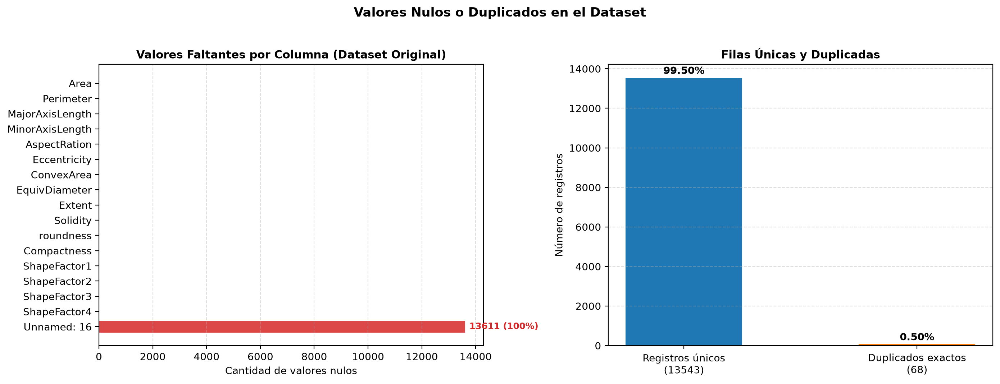
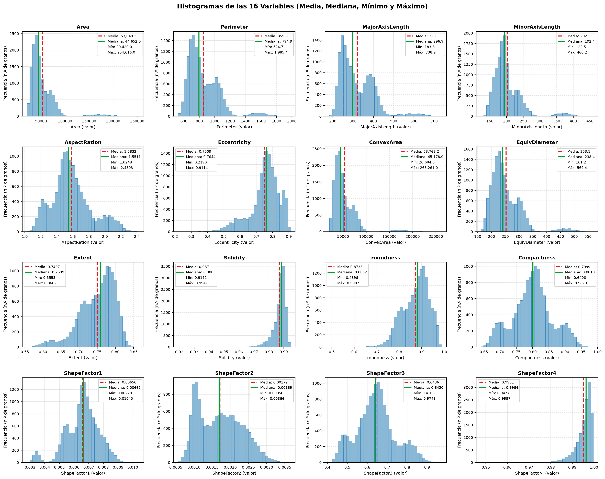
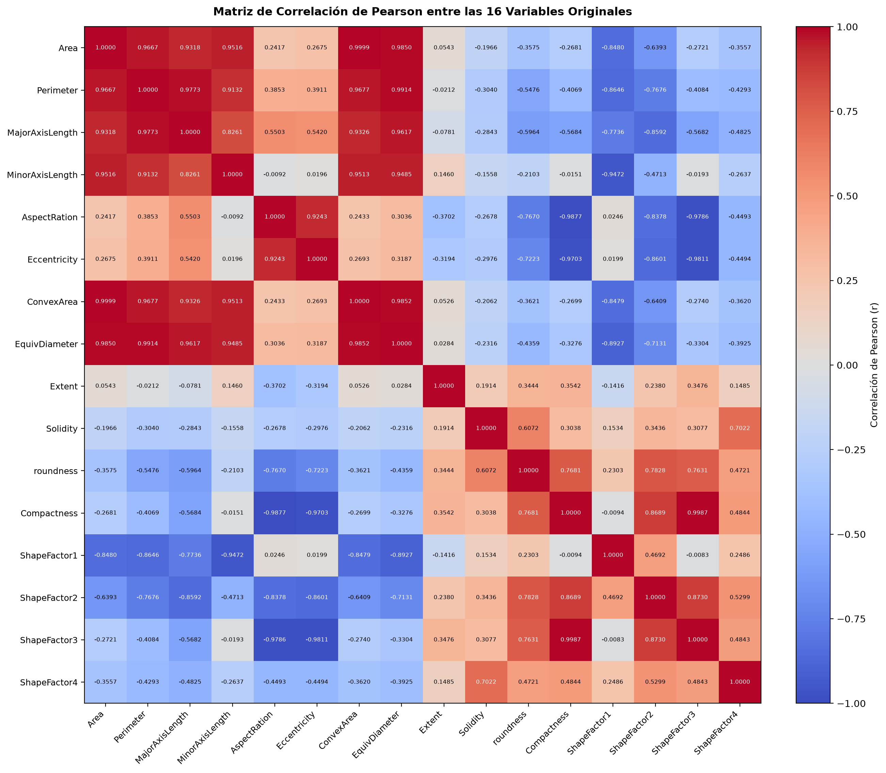
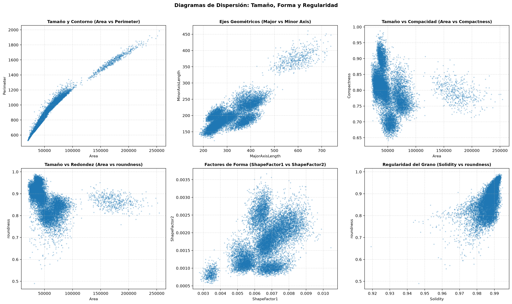

# Análisis Exploratorio del Dataset (`Dataset.csv`)

En esta etapa revisamos el archivo original **sin modificar ni borrar ningún dato**, y sin usar *boxplots*. El objetivo es entender qué contiene el dataset, detectar problemas de calidad y justificar de forma sencilla qué pasos se harán después en el preprocesamiento.

---

## Descripción Original del Conjunto de Datos (`Dataset.txt`)

- **Nombre del conjunto de datos:** `Dataset`
- **Resumen:** 13,611 granos. Se obtuvieron un total de 16 características a partir de los granos: 12 dimensiones y 4 formas.
- **Tipo de datos:** Multivariado
- **Tarea:** Clasificación
- **Tipo de atributo:** Categórico, Entero, Real
- **Tipo de formato:** Matriz
- **Número de instancias (registros en su conjunto de datos):** 13611
- **Número de atributos (campos dentro de cada registro):** 17
- **Información relevante:** En esta investigación se utilizaron diferentes tipos de granos, teniendo en cuenta características como la forma, la figura, el tipo y la estructura según la situación del mercado.

### Información de los atributos

- **Área (A):** El área de la zona de un grano y el número de píxeles dentro de sus límites.
- **Perímetro (P):** La circunferencia del grano se define como la longitud de su borde.
- **Longitud del eje mayor (L):** La distancia entre los extremos de la línea más larga que se puede trazar en un grano.
- **Longitud del eje menor (l):** La línea más larga que se puede trazar en el grano de forma perpendicular al eje principal.
- **Relación de aspecto (K):** Define la relación entre L y l.
- **Excentricidad (Ec):** Excentricidad de la elipse que tiene los mismos momentos que la región.
- **Área convexa (C):** Número de píxeles del polígono convexo más pequeño que puede contener el área de una semilla de grano.
- **Diámetro equivalente (Ed):** El diámetro de un círculo que tiene la misma área que el área de una semilla de grano.
- **Extensión (Ex):** La relación entre los píxeles del cuadro delimitador y el área del grano.
- **Solidez (S):** También conocida como convexidad. La relación entre los píxeles de la envolvente convexa y los que se encuentran en el grano.
- **Redondez (R):** Se calcula con la siguiente fórmula: `(4πA)/(P²)`
- **Compacidad (CO):** Mide la redondez de un objeto: `Ed/L`
- **Factor de forma 1 (SF1)**
- **Factor de forma 2 (SF2)**
- **Factor de forma 3 (SF3)**
- **Factor de forma 4 (SF4)**

---

## 1. Valores Nulos o Duplicados en el Dataset (`1_calidad_y_nulos.png`)

**¿Para qué sirve esta gráfica?** Para revisar si el archivo viene con datos faltantes o filas repetidas antes de hacer cualquier cálculo.

**¿Qué se encontró?**
- El archivo tiene **`13,611` filas** y **`17` columnas**.
- Las **`16` variables reales del grano** (`Area` hasta `ShapeFactor4`) están completas (**`0` valores nulos**) y todas son numéricas.
- Aparece automáticamente una columna extra llamada **`Unnamed: 16`** con **`13,611` valores nulos (`100%` vacía)** por una coma al final de cada línea del CSV (es el lugar donde iba la clase). Esto confirma que el problema es de **Aprendizaje No Supervisado**.
- Hay **`68` filas duplicadas exactas (`0.50%`)** y **`13,543` filas únicas (`99.50%`)**.

---

## 2. Distribuciones (`2_distribuciones_histogramas.png`)

**¿Para qué sirve esta gráfica?** Para ver qué valores toma cada variable (mínimo, máximo, media y mediana) y en qué zonas se concentra la mayoría de los granos.

**¿Qué se encontró?**
1. **Escalas muy distintas entre columnas:**
   - `Area` va de `20,420.0` a `254,616.0` píxeles (y `ConvexArea` llega hasta `263,261.0`).
   - En cambio, `ShapeFactor2` va de `0.00056` a `0.00366` y `ShapeFactor1` de `0.00278` a `0.01045`.
   - *Por qué importa:* Si medimos distancias sin estandarizar, `Area` dominaría por completo y los factores de forma casi no contarían.
2. **Varios picos ("montañitas") en las gráficas:**
   - Columnas como `MajorAxisLength`, `AspectRation`, `Compactness`, `ShapeFactor2` y `ShapeFactor3` muestran varios picos, lo que indica que hay distintos tipos de granos mezclados.
   - En las variables de tamaño (`Area`, `Perimeter`, `MinorAxisLength`, `ConvexArea` y `EquivDiameter`) se distingue aparte un grupo de granos mucho más grandes a la derecha (`Area > 125,000`).
3. **Valores extremos y posibles granos irregulares:**
   - En `Solidity` (`0.9192` a `0.9947`) y `ShapeFactor4` (`0.9477` a `0.9997`), casi todos los granos están cerca de `0.99`, pero hay una cola hacia valores bajos que apunta a granos deformes o posible ruido.

---

## 3. Correlaciones y Redundancias (`3_matriz_correlacion.png`)

**¿Para qué sirve esta gráfica?** Para ver qué variables suben o bajan juntas (es decir, qué columnas miden casi lo mismo).

**¿Qué se encontró?**
- Existen dos bloques de variables con relación muy fuerte ($|r| > 0.95$):
  - **Tamaño:** `Area` y `ConvexArea` (`0.9999`), `Perimeter` y `EquivDiameter` (`0.9914`), `Area` y `EquivDiameter` (`0.9850`), `Perimeter` y `MajorAxisLength` (`0.9773`).
  - **Forma:** `Compactness` y `ShapeFactor3` (`0.9987`), `AspectRation` y `Compactness` (`-0.9877`), `Eccentricity` y `ShapeFactor3` (`-0.9811`).
- Ninguna columna es constante (todas cambian y tienen varianza mayor a cero).

---

## 4. Diagramas de Dispersión (`4_dispersion_variables_originales.png`)

**¿Para qué sirve esta gráfica?** Para cruzar pares de variables en 2D y ver si los granos forman grupos separados o si hay puntos sueltos raros (posible ruido). Se eligieron pares que aportan información distinta en lugar de pares redundantes.

**¿Qué se encontró?**
- **`Area vs Perimeter` y `MajorAxisLength vs MinorAxisLength`:** Separan claramente la nube principal de granos pequeños/medianos del grupo de granos muy grandes, con algunos puntos sueltos entre ambos.
- **`Area vs Compactness` y `Area vs roundness`:** Dejan ver varios grupos densos naturales al combinar tamaño con forma.
- **`ShapeFactor1 vs ShapeFactor2` (`r = 0.4692`):** Al no estar tan correlacionadas, abren el plano y muestran varios grupos bien diferenciados (incluida la isla de granos grandes a la izquierda) junto con puntos dispersos alrededor.
- **`Solidity vs roundness`:** Muestra un bloque compacto de granos regulares arriba a la derecha (`Solidity > 0.98`, `roundness > 0.80`) y **puntos aislados** hacia abajo y a la izquierda (`Solidity < 0.97`, `roundness < 0.70`), que corresponden a granos irregulares o posible ruido.

---

## 5. Proyección PCA 2D sin Etiquetas: Forma de la Nube y Densidad (`6_pca_2d_densidad.png`)

**¿Para qué sirve esta gráfica?** Como no podemos dibujar 16 dimensiones a la vez, se usa **PCA solo como cámara visual** para proyectar las 16 variables a 2 ejes (`PC1 = 55.47%` y `PC2 = 26.43%`, conservando el **`81.90%`** de la información) sin usar colores de clase. El dataset **no se reduce**: esta proyección es únicamente para mirar la nube completa.

- **Panel izquierdo (Alpha bajo):** Cada punto es casi transparente; donde se ve más oscuro es donde se enciman más granos. Muestra la **forma de la nube**.
- **Panel derecho (Hexbin):** Cuenta cuántos granos caen en cada hexágono. Muestra **dónde hay mayor densidad**.

**¿Qué se encontró?**
1. **Formas irregulares y distintas densidades:** La nube no está hecha de bolitas redondas ni parejas; hay zonas alargadas y grupos más densos que otros (justo el tipo de datos donde *K-means* falla y donde conviene **DBSCAN**, `9 Clustering.pdf`, Diap. 22).
2. **Zonas donde se acumulan los puntos:** Se distinguen 4 núcleos densos en la nube principal (el más oscuro abajo-izquierda, uno alargado arriba-izquierda y dos a la derecha) más **una isla separada arriba a la derecha** que es menos densa (los granos muy grandes).
3. **Puntos sueltos en los bordes (gris muy claro):** Alrededor de las nubes aparecen puntos aislados con muy baja densidad (`1` a `2` granos por hexágono), que corresponden al **ruido global** que se filtrará después con DBSCAN.

---

## 6. Resumen: Qué se encontró y Qué se hará en el Preprocesamiento

Con base en todo lo observado, en `Preprocesamiento/preprocesamiento.py` se ejecutarán estos pasos:

| Qué se encontró | Qué se hará en el preprocesamiento | Base teórica |
| :--- | :--- | :--- |
| La columna **`Unnamed: 16`** está `100%` vacía (`13,611` nulos) por una coma extra; las `16` columnas reales no tienen nulos. | Detectar y eliminar automáticamente cualquier columna completamente vacía, sin borrar filas válidas. | `4 Preprocesamiento de datos.pdf` (Diaps. 45 y 50) |
| Hay **`68` filas duplicadas exactas (`0.50%`)**. | Eliminar duplicados con `drop_duplicates()` para no alterar la densidad ni los clusters. | `4 Preprocesamiento de datos.pdf` (Diaps. 32–35) |
| Todas las `16` variables tienen varianza $> 0$ (no hay columnas constantes). | Comprobar que ninguna columna sea constante y mantener las `16` variables originales para el clustering. | `4 Preprocesamiento de datos.pdf` (Diap. 76); `9 Clustering.pdf` (Diaps. 11 y 20) |
| Las escalas son muy distintas (`Area` hasta `254,616.0` vs `ShapeFactor2` desde `0.00056`). | Aplicar **Estandarización Z-score** (`StandardScaler`) para poner todas las variables en la misma escala antes de medir distancias. | `4 Preprocesamiento de datos.pdf` (Diap. 91); `9 Clustering.pdf` (Diaps. 11 y 21) |
| Hay nubes de formas irregulares, densidades distintas y puntos aislados alrededor. | Aplicar **DBSCAN** sobre las `16` variables estandarizadas para detectar y eliminar el **ruido global**, evaluar el resultado con métricas internas (Silhouette, Davies-Bouldin, Calinski-Harabasz, n.º de clusters y % de ruido) y asignar la columna `Clase` a los grupos encontrados. | `4 Preprocesamiento de datos.pdf` (Diaps. 52, 59 y 62); `9 Clustering.pdf` (Diaps. 22–27 y 30) |
