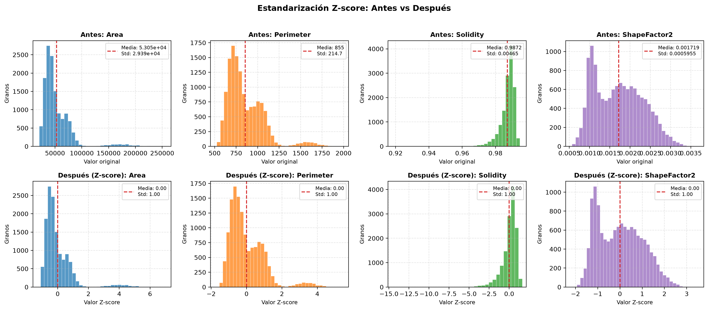
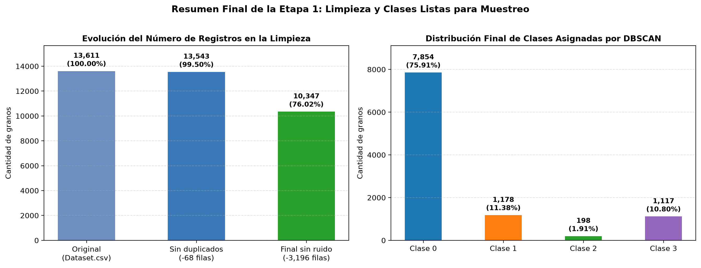

# Resumen de Preprocesamiento (Inciso 1 del Examen)

Este documento explica de forma clara y directa cómo funciona el script [`preprocesamiento.py`](preprocesamiento.py) para cumplir con lo solicitado en la **Etapa 1** del examen: limpiar los datos, elegir la medida de distancia, ajustar DBSCAN para eliminar el ruido global, medir la calidad de los grupos y asignarles su etiqueta de clase.

---

## 1. Limpieza de los Datos

El archivo original `Dataset.csv` tiene 13,611 filas y 17 columnas. Se realizaron tres pasos de limpieza:

1. **Eliminar columna vacía:** Se quitó la columna `Unnamed: 16` porque estaba 100% vacía (generada por una coma de más al final del CSV). Las 16 variables reales del grano no tienen ningún valor nulo.
2. **Eliminar duplicados:** Se quitaron **68 filas repetidas**, quedando **13,543 registros únicos**. Esto evita que datos repetidos alteren el cálculo de densidades.
3. **Estandarización (Z-score):** Variables como el `Area` tienen valores de hasta 254,000, mientras que otras como `ShapeFactor2` valen 0.0017. Si no se estandarizan, el cálculo de distancias de DBSCAN solo tomaría en cuenta el área. Con Z-score, todas las 16 variables quedan con media 0 y desviación estándar 1, teniendo el mismo peso.

---

## 2. Medida de Distancia y Ajuste de DBSCAN

Antes de ejecutar DBSCAN se define cómo se medirá la cercanía entre granos (`9 Clustering.pdf`, Diaps. 5, 11 y 21):

- **Distancia Manhattan ($L_1$):** $d(x, y) = \sum_{i=1}^{16} |x_i - y_i|$. Es una métrica formal con bajo costo computacional y, en varias dimensiones (16D), es menos sensible a valores extremos aislados en una sola variable que la distancia euclidiana (que eleva las diferencias al cuadrado).

DBSCAN necesita dos parámetros principales: `MinPts` (mínimo de puntos para formar un grupo) y `eps` (radio de distancia Manhattan).

1. **`MinPts = 32`:** Como el dataset tiene 16 variables numéricas ($D = 16$), se usa la regla práctica:
   $$\text{MinPts} = 2 \times D = 32$$
2. **Curva de 32-distancias Manhattan para encontrar `eps`:** Se calculó la distancia Manhattan de cada grano a su vecino número 32 más cercano y se ordenaron de menor a mayor.
   - En la gráfica se observa el inicio del "codo" (donde la curva empieza a subir con fuerza) entre **3.56** (P85) y **4.02** (P90). Los puntos por encima de esa zona son datos aislados (ruido global).

---

## 3. Métricas de Calidad de los Grupos

Para elegir el mejor valor de `eps` dentro del inicio del codo, se evaluaron las tres métricas estándar de calidad de agrupamiento (`9 Clustering.pdf`, Diaps. 27 y 30):

* **Silhouette con distancia Manhattan (más alto es mejor):** Mide qué tan separados y bien definidos están los grupos.
* **Davies-Bouldin (más bajo es mejor):** Mide la dispersión dentro de cada grupo y la distancia entre ellos.
* **Calinski-Harabasz (más alto es mejor):** Relaciona la separación entre clusters con su compacidad.

| `eps` | MinPts | Grupos | Ruido (#) | % Ruido | Silhouette ($\uparrow$) | Davies-Bouldin ($\downarrow$) | Calinski-Harabasz ($\uparrow$) |
| :---: | :---: | :---: | :---: | :---: | :---: | :---: | :---: |
| 2.00 | 32 | 5 | 5,889 | 43.48% | 0.4889 | 0.9891 | 826.6 |
| 2.25 | 32 | 3 | 4,376 | 32.31% | 0.5131 | 0.7933 | 4,095.2 |
| **2.50** | **32** | **4** | **3,196** | **23.60%** | **0.4026** | **1.0376** | **3,794.7** |
| 3.00 | 32 | 2 | 1,587 | 11.72% | 0.5582 | 0.3974 | 510.4 |
| 3.50 | 32 | 2 | 768 | 5.67% | 0.5543 | 0.4824 | 2,616.0 |
| 4.00 | 32 | 2 | 449 | 3.32% | 0.5534 | 0.5066 | 3,310.4 |
| 4.50 | 32 | 2 | 256 | 1.89% | 0.5542 | 0.5232 | 3,743.0 |

**Configuración elegida: `eps = 2.50`, `MinPts = 32` y `metric = "manhattan"`**
Al usar `eps = 2.50`, DBSCAN logra romper los puentes de densidad entre subgrupos y separar **4 clusters bien diferenciados** con un Calinski-Harabasz alto ($3,794.7$) y Silhouette positivo ($0.4026$), descartando como ruido global los **3,196 granos (23.60%)** que se encuentran en zonas de transición o baja densidad.

---

## 4. Eliminación de Ruido y Visualización

Al aplicar DBSCAN con distancia Manhattan y estos parámetros:
- Se identifican **4 clusters naturales**.
- Se detectan **3,196 puntos de ruido global** (granos atípicos o en zonas dispersas, marcados con etiqueta `-1`).
- Se eliminan estos 3,196 puntos de ruido, dejando los 4 grupos limpios y claramente delimitados.

---

## 5. Asignación de Clases y Dataset Resultante

A los datos limpios se les asignó formalmente la columna **`Clase`** según el grupo identificado por DBSCAN:

* **Clase 0:** 7,854 granos (75.91%)
* **Clase 1:** 1,178 granos (11.38%)
* **Clase 2:** 198 granos (1.91%)
* **Clase 3:** 1,117 granos (10.80%)
* **Total final:** **10,347 registros** con 17 columnas (16 variables estandarizadas + `Clase`).

El archivo final se guardó como [`dataset_preprocesado.csv`](dataset_preprocesado.csv).

---

## Resumen de lo Solicitado vs lo Realizado

| Requisito del Examen | ¿Qué se hizo? |
| :--- | :--- |
| **Limpieza de problemas:** | Se quitó la columna vacía, los 68 duplicados y se estandarizó con Z-score. |
| **Medida de distancia y DBSCAN:** | Se usó **distancia Manhattan** y se ajustaron los parámetros ($\text{MinPts}=32$, $\text{eps}=2.50$) separando 4 estratos densos. |
| **Métricas de calidad:** | Se evaluaron Silhouette (Manhattan), Davies-Bouldin y Calinski-Harabasz. |
| **Documentación:** | Se explicó el procedimiento paso a paso respaldado por las 5 gráficas. |
| **Archivo `preprocesamiento.py`:** | Script funcional que ejecuta todo el flujo de forma automática. |
| **Asignar valor de clase:** | Se crearon las etiquetas `Clase 0`, `Clase 1`, `Clase 2` y `Clase 3` en `dataset_preprocesado.csv`. |
