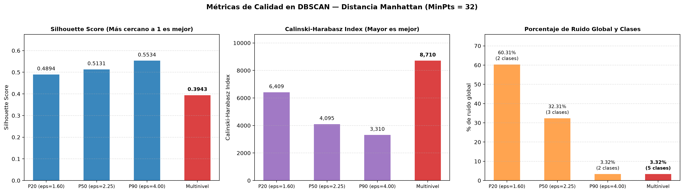
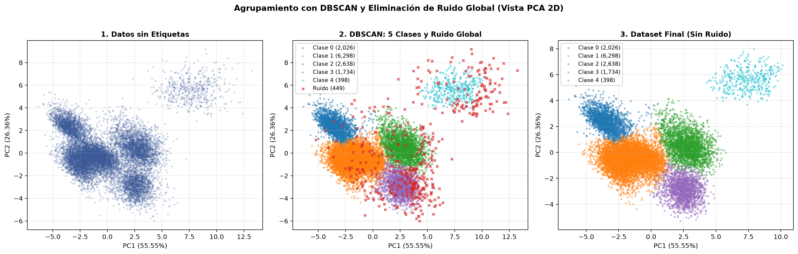

# Etapa 1: Preprocesamiento y Detección de Ruido Global con DBSCAN

En esta etapa se ejecuta [`preprocesamiento.py`](preprocesamiento.py) sobre `Dataset.csv` para limpiar los datos, aplicar DBSCAN en la detección de ruido global, evaluar la calidad de los grupos y asignar una etiqueta de `Clase`.

---

## 1. Limpieza y Estandarización

A partir de `Dataset.csv` (`13,611` filas y `17` columnas) se hicieron tres pasos básicos:

1. **Quitar la columna vacía:** se eliminó `Unnamed: 16` (estaba `100%` vacía por una coma extra al final del CSV). Las `16` variables del grano no tienen datos faltantes ni varianza cero.
2. **Quitar duplicados:** se eliminaron **`68` filas repetidas**, quedando **`13,543` granos únicos**.
3. **Estandarizar con Z-score:** como `Area` llega a `254,616` y `ShapeFactor2` ronda `0.0017`, se aplicó `StandardScaler` para dejar las `16` variables con media `0.00` y desviación estándar `1.00`, de modo que todas pesen igual al medir distancias.

---

## 2. Medida de Distancia y Ajuste de DBSCAN Multinivel

- **Distancia Manhattan ($L_1$):** suma las diferencias absolutas entre las 16 variables (`metric="manhattan"`). Es rápida y menos sensible a valores extremos en una sola columna.
- **`MinPts = 32`:** regla práctica calculada a partir del número de variables ($\text{MinPts} = 2 \times 16 = 32$).

### ¿Por qué aplicamos un DBSCAN Multinivel (por niveles de densidad)?
En el análisis exploratorio vimos que las **5 nubes de granos no tienen la misma densidad**: las dos de la izquierda están muy pegadas (alta densidad), las de centro y abajo a la derecha tienen densidad media, y la isla de arriba a la derecha está mucho más dispersa (baja densidad).

Si se usara un solo `eps` fijo para todo el dataset:
- Con un **`eps` pequeño** se separan las dos nubes muy pegadas de la izquierda, pero las demás se pierden como ruido.
- Con un **`eps` grande** se alcanza a detectar la isla dispersa de arriba, pero las 4 nubes de abajo se pegan en una sola.

Para **ajustar DBSCAN a los requerimientos del dataset**, calculamos **3 niveles de `eps` directamente desde los percentiles de la curva de 32-distancias** (redondeados al múltiplo de `0.05` más cercano):
1. **Nivel 3 — Filtro de ruido global (`P90`, `eps = 4.00`):** separa el **ruido global real (`-1`)** de las regiones válidas del dataset (elimina únicamente los **`449` puntos aislados = `3.32%`** sin comerse los bordes de ningún grupo) y separa la isla dispersa de arriba a la derecha (`Clase 4`).
2. **Niveles 1 y 2 — Núcleos internos (`P20`, `eps = 1.60` y `P50`, `eps = 2.25`):** localizan los 4 núcleos densos dentro de la nube principal (**arriba-izquierda**, **abajo-izquierda**, **centro-derecha** y **abajo-derecha**).
3. **Asignación de las 5 clases:** cada punto válido que pasó el filtro de ruido global (`P90`) se asigna a su núcleo interno más cercano en distancia Manhattan, conservando completos los 5 grupos.

---

## 3. Métricas de Calidad

Evaluamos los estratos generados con dos métricas de calidad más el conteo de clases y el porcentaje de ruido global:
- **Silhouette Score (con distancia Manhattan):** mide qué tan parecidos son los granos de un mismo grupo frente a los demás (entre `-1` y `1`; más cercano a `1` es mejor).
- **Calinski-Harabasz Index:** compara qué tan separados están los grupos contra qué tan apretados están por dentro (**mientras más alto, mejor**).
- **Número de clases** y **porcentaje de ruido global (`-1`)**.

| Configuración (`MinPts = 32`) | Clases | Ruido (#) | % Ruido | Silhouette Score | Calinski-Harabasz |
| :---: | :---: | :---: | :---: | :---: | :---: |
| `P20 (eps = 1.60)` | 2 | 8,168 | 60.31% | 0.4894 | 6,409.1 |
| `P50 (eps = 2.25)` | 3 | 4,376 | 32.31% | 0.5131 | 4,095.2 |
| `P90 (eps = 4.00)` | 2 | 449 | 3.32% | 0.5534 | 3,310.4 |
| **Multinivel** | **5** | **449** | **3.32%** | **0.3943** | **8,709.6** |

El enfoque **Multinivel** obtiene el **Calinski-Harabasz más alto (`8,709.6`, más del doble que con 2 clases)**, un **Silhouette Score positivo (`0.3943`, normal cuando 5 grupos reales comparten fronteras cercanas en 16 dimensiones)**, y conserva el **`96.68%`** de los granos únicos (eliminando solo el **`3.32%`** de ruido global real).

---

## 4. Eliminación de Ruido Global

Los **`449` granos (`3.32%`)** que quedan aislados fuera de las regiones densas (`P90`) se marcan como **ruido global (`-1`)** y se eliminan del dataset. En la gráfica (proyectada en PCA 2D solo para ver el resultado) se aprecia el antes, el ruido en rojo únicamente en las orillas y los 5 grupos completos:

---

## 5. Clases Asignadas y Dataset Final

A los **`13,094` registros limpios** se les agregó la columna **`Clase`** y se guardaron en [`dataset_preprocesado.csv`](dataset_preprocesado.csv) (`13,094` filas × `17` columnas):

- **Clase 0 (arriba-izquierda):** `2,026` granos (`15.47%`)
- **Clase 1 (abajo-izquierda):** `6,298` granos (`48.10%`)
- **Clase 2 (centro-derecha):** `2,638` granos (`20.15%`)
- **Clase 3 (abajo-derecha):** `1,734` granos (`13.24%`)
- **Clase 4 (isla arriba-derecha):** `398` granos (`3.04%`)

---

## Cumplimiento del Inciso 1 del Examen

| Requisito | Cumplimiento |
| :--- | :--- |
| Limpiar problemas del dataset | Se quitó `Unnamed: 16`, `68` duplicados, se verificó varianza $> 0$ y se aplicó Z-score. |
| Detectar ruido global con DBSCAN | DBSCAN Multinivel con distancia Manhattan (`MinPts = 32`, `P20 / P50 / P90`) eliminó `449` puntos de ruido global (`3.32%`). |
| Elegir métricas de calidad | Silhouette Score (`0.3943`), Calinski-Harabasz (`8,709.6`), número de clases (`5`) y `%` de ruido (`3.32%`). |
| Documentación y script | Este documento, 5 gráficas y [`preprocesamiento.py`](preprocesamiento.py). |
| Asignar valor de clase | Columna `Clase` (`0` a `4`) en [`dataset_preprocesado.csv`](dataset_preprocesado.csv). |
