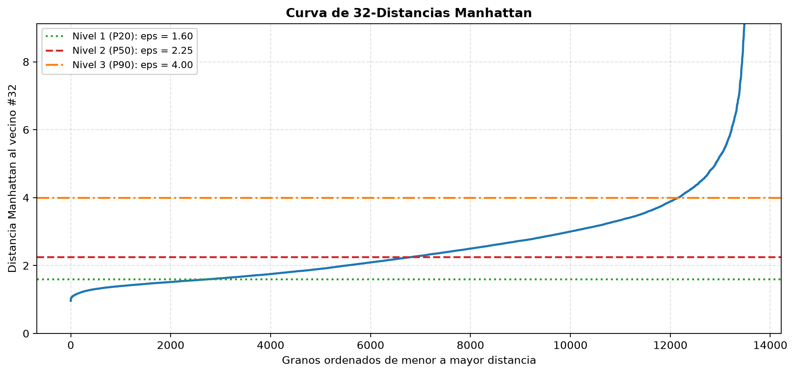

# Resumen de Preprocesamiento (Inciso 1 del Examen)

Este documento explica de forma clara y directa cómo funciona el script [`preprocesamiento.py`](preprocesamiento.py) para cumplir con lo solicitado en la **Etapa 1** del examen: limpiar los datos, ajustar DBSCAN para eliminar el ruido global, medir la calidad de los grupos y asignarles su etiqueta de clase.

---

## 1. Limpieza de los Datos

El archivo original `Dataset.csv` tiene 13,611 filas y 17 columnas. Se realizaron tres pasos de limpieza:

1. **Eliminar columna vacía:** Se quitó la columna `Unnamed: 16` porque estaba 100% vacía (generada por una coma de más al final del CSV). Las 16 variables reales del grano no tienen ningún valor nulo.
2. **Eliminar duplicados:** Se quitaron **68 filas repetidas**, quedando **13,543 registros únicos**. Esto evita que datos repetidos alteren el cálculo de densidades.
3. **Estandarización (Z-score):** Variables como el `Area` tienen valores de hasta 254,000, mientras que otras como `ShapeFactor2` valen 0.0017. Si no se estandarizan, el cálculo de distancias de DBSCAN solo tomaría en cuenta el área. Con Z-score, todas las 16 variables quedan con media 0 y desviación estándar 1, teniendo el mismo peso.

---

## 2. Ajuste de DBSCAN y Detección del Ruido Global

DBSCAN necesita dos parámetros principales: `MinPts` (mínimo de puntos para formar un grupo) y `eps` (radio de distancia).

1. **`MinPts = 32`:** Como el dataset tiene 16 variables numéricas ($D = 16$), se usa la regla práctica:
   $$\text{MinPts} = 2 \times D = 32$$
2. **Curva de 32-distancias para encontrar `eps`:** Se calculó la distancia de cada grano a su vecino número 32 más cercano y se ordenaron de menor a mayor.
   - En la gráfica se observa un "codo" (donde la curva se dispara bruscamente hacia arriba) entre **1.42** y **1.76**. Los puntos por encima de esa curva son datos aislados (ruido global).

---

## 3. Métricas de Calidad de los Grupos

Para elegir el mejor valor de `eps` dentro de la zona del codo, se evaluaron las tres métricas estándar de calidad de agrupamiento:

* **Silhouette (más alto es mejor):** Mide qué tan separados y bien definidos están los grupos.
* **Davies-Bouldin (más bajo es mejor):** Mide la dispersión dentro de cada grupo y la distancia entre ellos.
* **Calinski-Harabasz (más alto es mejor):** Relaciona la separación entre clusters con su compacidad.

| `eps` | MinPts | Grupos | Ruido (#) | % Ruido | Silhouette ($\uparrow$) | Davies-Bouldin ($\downarrow$) | Calinski-Harabasz ($\uparrow$) |
| :---: | :---: | :---: | :---: | :---: | :---: | :---: | :---: |
| 0.90 | 32 | 3 | 2,941 | 21.72% | 0.2416 | 0.9698 | 2,108.1 |
| 1.20 | 32 | 2 | 934 | 6.90% | 0.5731 | 0.4766 | 2,515.2 |
| 1.40 | 32 | 2 | 515 | 3.80% | 0.5692 | 0.5072 | 3,404.8 |
| **1.50** | **32** | **2** | **402** | **2.97%** | **0.5703** | **0.5136** | **3,664.6** |
| 1.60 | 32 | 2 | 322 | 2.38% | 0.5700 | 0.5192 | 3,822.4 |
| 1.80 | 32 | 2 | 204 | 1.51% | 0.5697 | 0.5283 | 4,001.6 |
| 2.00 | 32 | 2 | 128 | 0.95% | 0.5707 | 0.5356 | 4,169.6 |

**Configuración elegida: `eps = 1.50` y `MinPts = 32`**
Es el punto donde se obtiene un excelente Silhouette ($0.5703$) y Davies-Bouldin ($0.5136$), eliminando únicamente el **2.97%** de granos aislados (ruido global) sin perder datos válidos.

---

## 4. Eliminación de Ruido y Visualización

Al aplicar DBSCAN con estos parámetros:
- Se identifican **2 clusters naturales**.
- Se detectan **402 puntos de ruido global** (granos atípicos o aislados, marcados con etiqueta `-1`).
- Se eliminan estos 402 puntos de ruido, dejando ambos grupos limpios y claramente delimitados.

---

## 5. Asignación de Clases y Dataset Resultante

A los datos limpios se les asignó formalmente la columna **`Clase`** según el grupo identificado por DBSCAN:

* **Clase 0:** 12,705 granos (96.68%)
* **Clase 1:** 436 granos (3.32%)
* **Total final:** **13,141 registros** con 17 columnas (16 variables estandarizadas + `Clase`).

El archivo final se guardó como [`dataset_preprocesado.csv`](dataset_preprocesado.csv).

---

## Resumen de lo Solicitado vs lo Realizado

| Requisito del Examen | ¿Qué se hizo? |
| :--- | :--- |
| **Limpieza de problemas:** | Se quitó la columna vacía, los 68 duplicados y se estandarizó con Z-score. |
| **Detección de ruido global con DBSCAN:** | Se ajustaron los parámetros con la curva de distancias ($\text{MinPts}=32$, $\text{eps}=1.50$). |
| **Métricas de calidad:** | Se evaluaron Silhouette, Davies-Bouldin y Calinski-Harabasz. |
| **Documentación:** | Se explicó el procedimiento paso a paso respaldado por las 5 gráficas. |
| **Archivo `preprocesamiento.py`:** | Script funcional que ejecuta todo el flujo de forma automática. |
| **Asignar valor de clase:** | Se crearon las etiquetas `Clase 0` y `Clase 1` en `dataset_preprocesado.csv`. |
