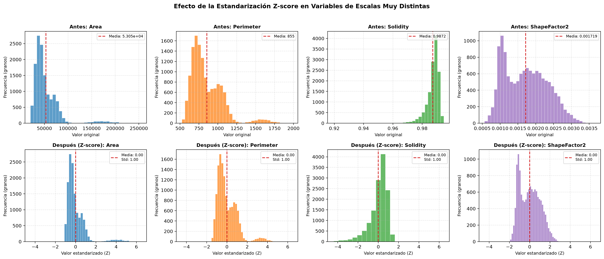
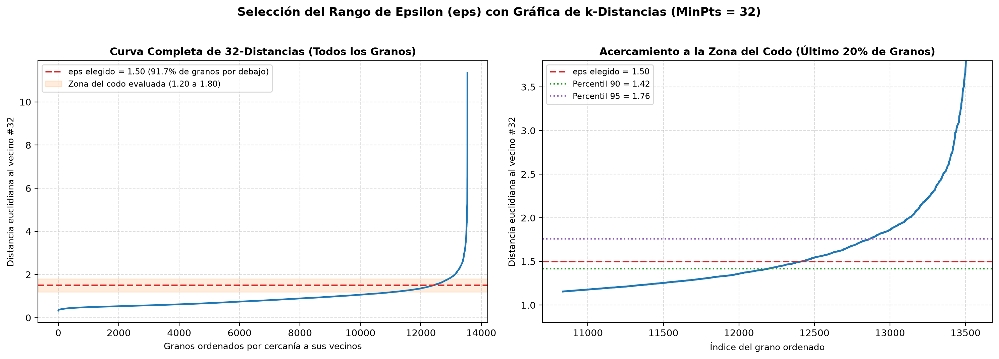
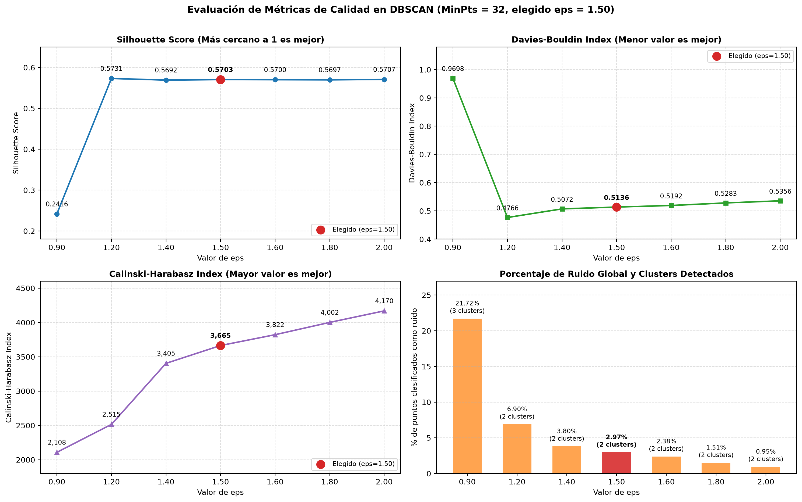
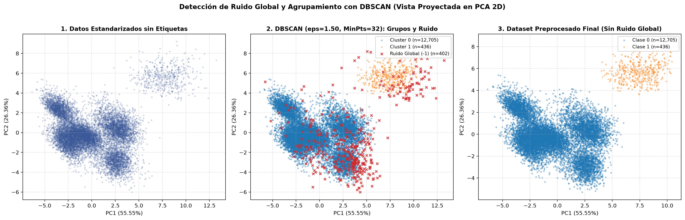
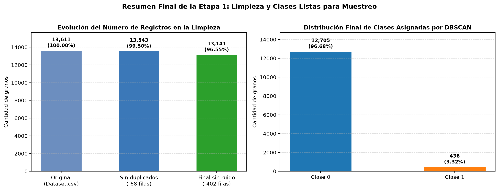

# Etapa 1: Preprocesamiento de Datos y Detección de Ruido Global con DBSCAN

En esta etapa aplicamos en [preprocesamiento.py](preprocesamiento.py) todas las soluciones a los problemas encontrados en el análisis exploratorio de `Dataset.csv`, cumpliendo los requisitos de la **Etapa 1** del examen (`2o parcial.pdf`):

1. Limpiar los problemas del dataset (columna vacía, duplicados y diferencias extremas de escala).
2. Aplicar **DBSCAN** ajustado al dataset para detectar y eliminar el **ruido global**.
3. Elegir y evaluar las **métricas de calidad** de los estratos generados.
4. Asignar un valor de **Clase** a los grupos encontrados y guardar `dataset_preprocesado.csv` listo para la Etapa 2 (muestreo).

---

## 1. Limpieza Inicial: Valores Faltantes, Duplicados y Varianza

Partiendo del archivo original (`13,611` filas $\times$ `17` columnas), el script realiza tres limpiezas básicas antes de cualquier cálculo:

- **Eliminación de columna vacía (`4 Preprocesamiento de datos.pdf`, Diaps. 45 y 50):** Se detecta automáticamente la columna `Unnamed: 16` con `13,611` valores nulos (`100%` vacía por la coma final del CSV) y se elimina. Las `16` columnas válidas del grano tienen **`0` valores faltantes**, por lo que no hace falta imputar ni borrar filas por nulos.
- **Eliminación de duplicados exactos (`4 Preprocesamiento de datos.pdf`, Diaps. 32–35):** Se eliminan **`68` filas repetidas** con `drop_duplicates(keep="first")`, dejando **`13,543` granos únicos**. Esto evita que filas repetidas inflen artificialmente la densidad de un punto en DBSCAN.
- **Revisión de varianza cero (`4 Preprocesamiento de datos.pdf`, Diap. 76):** Se comprueba que las `16` variables tienen varianza mayor a cero (no hay columnas constantes), por lo que todas se conservan. No se usan métodos de selección supervisada porque en esta etapa todavía no existen etiquetas.

---

## 2. Estandarización Z-score (`1_antes_despues_estandarizacion.png`)

**¿Por qué se hace?**
En el análisis vimos que `Area` llega hasta `254,616` mientras `ShapeFactor2` está alrededor de `0.0017`. Como DBSCAN mide distancias euclidianas entre granos, si no igualamos las escalas, `Area` dominaría por completo la distancia y las columnas pequeñas casi no contarían (`4 Preprocesamiento de datos.pdf`, Diap. 91; `9 Clustering.pdf`, Diaps. 11 y 21).

**¿Qué muestra la gráfica?**
- **Fila superior (Antes):** Cada variable está en una escala totalmente distinta (`Area` en cientos de miles, `Perimeter` en cientos, `Solidity` entre `0.92` y `0.99`, `ShapeFactor2` en milésimas).
- **Fila inferior (Después de Z-score):** Con `StandardScaler` ($z = \frac{x - \mu}{\sigma}$), las `16` variables quedan centradas en **media `0.00`** y **desviación estándar `1.00`**, conservando la forma real de sus datos pero ahora todas pesan igual al calcular distancias.

---

## 3. Cómo se Ajustó DBSCAN: `MinPts` y Curva de $k$-Distancias (`2_curva_k_distancia_dbscan.png`)

**¿Por qué DBSCAN y no otros métodos?**
- No usamos reglas univariadas como *IQR* o *Z-score > 3* columna por columna (`4 Preprocesamiento de datos.pdf`, Diap. 62), porque un grano puede ser grande en `Area` y aun así pertenecer a una variedad válida.
- Tampoco usamos *K-means* (`4 Preprocesamiento de datos.pdf`, Diap. 58; `9 Clustering.pdf`, Diap. 22), porque mete todos los puntos a la fuerza en algún grupo y no separa el ruido global.
- **DBSCAN** (`4 Preprocesamiento de datos.pdf`, Diap. 59; `9 Clustering.pdf`, Diaps. 22–25) busca zonas densas en las **16 dimensiones al mismo tiempo** y marca automáticamente como **ruido global (`-1`)** a los granos aislados que no pertenecen a ninguna zona densa.

**¿Cómo se eligieron sus dos parámetros (`MinPts` y `eps`)?**
1. **`MinPts = 32`:** Como trabajamos en `16` dimensiones ($D = 16$), aplicamos la regla estándar para varias dimensiones: $\text{MinPts} = 2 \times D = 32$ vecinos mínimos para formar una región densa.
2. **Rango de `eps` ($\varepsilon$) con la curva de 32-distancias:** Para cada grano medimos la distancia euclidiana a su vecino número `32` más cercano y ordenamos esas distancias de menor a mayor:
   - Al principio la curva sube despacio (granos dentro de zonas densas).
   - Al final (**panel derecho**, acercamiento al último 20%) la curva se dobla bruscamente hacia arriba ("el codo"), entre `1.20` y `1.80` (percentil 90 = `1.42`, percentil 95 = `1.76`): ahí es donde empiezan los puntos aislados (ruido global).

---

## 4. Evaluación con Métricas de Calidad (`3_metricas_calidad_dbscan.png`)

Siguiendo `9 Clustering.pdf` (Diaps. 26, 27 y 30), probamos distintos valores de `eps` alrededor del codo (manteniendo `MinPts = 32` y distancia euclidiana en **16D**) usando únicamente **métricas internas para datos sin etiquetas**:
- **Silhouette Score** (más cercano a `1` es mejor): mide qué tan bien agrupado y separado está cada cluster.
- **Davies-Bouldin Index** (menor es mejor): mide si los grupos están compactos y lejos entre sí.
- **Calinski-Harabasz Index** (mayor es mejor): compara la separación entre grupos contra la dispersión interna.
- **Número de clusters y % de ruido global** (`9 Clustering.pdf`, Diap. 30).

*(No se usan ARI ni NMI porque requieren etiquetas reales, ni el Método del Codo de inercia porque es de K-means; `9 Clustering.pdf`, Diaps. 28 y 29).*

| `eps` ($\varepsilon$) | `MinPts` | Clusters | Ruido global (`-1`) | % de Ruido | Silhouette ($\uparrow$) | Davies-Bouldin ($\downarrow$) | Calinski-Harabasz ($\uparrow$) |
| :---: | :---: | :---: | :---: | :---: | :---: | :---: | :---: |
| `0.90` | `32` | `3` | `2,941` | `21.72%` | `0.2416` | `0.9698` | `2,108.1` |
| `1.20` | `32` | `2` | `934` | `6.90%` | `0.5731` | `0.4766` | `2,515.2` |
| `1.40` | `32` | `2` | `515` | `3.80%` | `0.5692` | `0.5072` | `3,404.8` |
| **`1.50`** | **`32`** | **`2`** | **`402`** | **`2.97%`** | **`0.5703`** | **`0.5136`** | **`3,664.6`** |
| `1.60` | `32` | `2` | `322` | `2.38%` | `0.5700` | `0.5192` | `3,822.4` |
| `1.80` | `32` | `2` | `204` | `1.51%` | `0.5697` | `0.5283` | `4,001.6` |
| `2.00` | `32` | `2` | `128` | `0.95%` | `0.5707` | `0.5356` | `4,169.6` |

**¿Por qué elegimos `eps = 1.50` y `MinPts = 32`?**
- Con `eps = 0.90` se borra demasiado del dataset (`21.72%`) y la calidad cae (`Silhouette = 0.2416`, `Davies-Bouldin = 0.9698`).
- Con `eps = 1.20` el `Silhouette` es parecido (`0.5731`), pero elimina casi la mitad de la nube de granos grandes como si fuera ruido (`6.90%` total) y su `Calinski-Harabasz` es bajo (`2,515.2`).
- Con `eps = 2.00` el radio es demasiado grande y deja pasar casi todos los puntos periféricos (`0.95%` de ruido), empeorando `Davies-Bouldin` (`0.5356`).
- En **`eps = 1.50`** se logra el mejor equilibrio justo en el codo: **2 clusters muy bien separados** (`Silhouette = 0.5703`, `Davies-Bouldin = 0.5136`, `Calinski-Harabasz = 3,664.6`), conserva casi intacta la nube de granos grandes (`436` granos) y elimina únicamente los **`402` granos realmente aislados (`2.97%`)** como ruido global.

---

## 5. Resultado Visual de DBSCAN y Eliminación del Ruido Global (`4_dbscan_clustering_y_ruido.png`)

**¿Qué muestra la gráfica?**
Aunque DBSCAN se ejecutó sobre las **16 variables completas**, aquí proyectamos el resultado en **PCA 2D** solo para poder verlo en pantalla:
1. **Izquierda:** Los `13,543` granos estandarizados sin etiquetas.
2. **Centro:** El resultado de DBSCAN (`eps = 1.50, MinPts = 32`): identifica el **Cluster 0** (azul, `12,705` granos), el **Cluster 1** (naranja, `436` granos grandes) y marca en **cruces rojas (`-1`)** los **`402` puntos de ruido global** que flotan aislados en las orillas y entre nubes.
3. **Derecha:** El dataset limpio final tras eliminar las cruces rojas, con las fronteras de ambos grupos mucho más limpias y definidas.

**¿Por qué resultan 2 clases y no 4 si en el análisis se veían 4 zonas negras y 1 nube gris?**
- **Las 4 zonas negras están pegadas:** Como tienen muchos puntos intermedios que las conectan sin dejar espacio vacío entre ellas, DBSCAN las une en un solo grupo continuo (**`Clase 0`**). Si achicáramos el radio `eps` (a `0.70` u `0.80`) para forzar que esas 4 zonas se separen, DBSCAN borraría entre el `32%` y el `45%` de todo el dataset como si fuera ruido y empeorarían las métricas de calidad.
- **La nube gris de arriba sí es una clase (`Clase 1`) y no ruido:** Aunque en el mapa de densidad se veía gris más claro por tener menos cantidad de datos, agrupa a `436` granos grandes muy parecidos entre sí (todos con al menos `32` vecinos cercanos) y está completamente separada de la nube principal.
- **El ruido real (`-1`) son solo las orillas:** Únicamente los `402` puntos (`2.97%`) que quedaron sueltos alrededor de las nubes sin vecinos suficientes se eliminan.

---

## 6. Dataset Final y Clases Asignadas (`5_resumen_preprocesamiento_y_clases.png`)

Al eliminar los `402` puntos marcados como ruido global (`-1`) y asignar la etiqueta de **`Clase`** a los grupos descubiertos, el dataset preprocesado se guarda en **`dataset_preprocesado.csv`**:

- **Registros iniciales (`Dataset.csv`):** `13,611` filas $\times$ `17` columnas (con `Unnamed: 16` vacía).
- **Tras quitar columna vacía y `68` duplicados:** `13,543` filas $\times$ `16` columnas.
- **Tras quitar `402` puntos de ruido global (`2.97%`):** **`13,141` filas $\times$ `17` columnas** (`16` variables estandarizadas + columna `Clase`).

**Distribución de clases asignadas:**
- **`Clase 0`:** `12,705` granos (**`96.68%`**)
- **`Clase 1`:** `436` granos (**`3.32%`**)

> **Conexión con la Etapa 2 (`muestreo.py`):** Como la `Clase 1` representa el `3.32%` del total, en la siguiente etapa será indispensable aplicar **muestreo estratificado** para que `train`, `validation`, `test` y la validación cruzada mantengan exactamente esta proporción y no se pierdan ejemplos de la clase minoritaria.

---

## 7. Verificación contra lo que Pide el Examen (`2o parcial.pdf` — Etapa 1)

| Requisito de la Etapa 1 | Cómo se cumplió | Evidencia |
| :--- | :--- | :--- |
| Eliminar problemas del dataset (ruido, desviaciones, etc.) | Se eliminó la columna vacía `Unnamed: 16`, los `68` duplicados exactos, se corrigieron las escalas con **Z-score** y se eliminaron `402` puntos de ruido global. | `1_antes_despues_estandarizacion.png` y `5_resumen_preprocesamiento_y_clases.png` |
| Usar **DBSCAN** para detección de ruido global ajustado al dataset | Se usó `MinPts = 2 × 16 = 32`, curva de 32-distancias y búsqueda de `eps` en el codo, eligiendo `eps = 1.50` sobre el espacio 16D. | `2_curva_k_distancia_dbscan.png` y `4_dbscan_clustering_y_ruido.png` |
| Elegir métricas para medir la calidad de los estratos | Se evaluaron **Silhouette (`0.5703`)**, **Davies-Bouldin (`0.5136`)**, **Calinski-Harabasz (`3,664.6`)**, n.º de clusters (`2`) y % de ruido (`2.97%`). | `3_metricas_calidad_dbscan.png` y tabla de la Sección 4 |
| Documentar cómo se aplicó el algoritmo al problema | Documentado paso a paso con gráficas y referencias a las diapositivas del curso. | Este documento (`RESUMEN_PREPROCESAMIENTO.md`) |
| Generar el archivo de código y asignar valor de clase a los grupos | Código implementado y dataset limpio con columna `Clase` (`0` y `1`) guardado. | `preprocesamiento.py` y `dataset_preprocesado.csv` |
